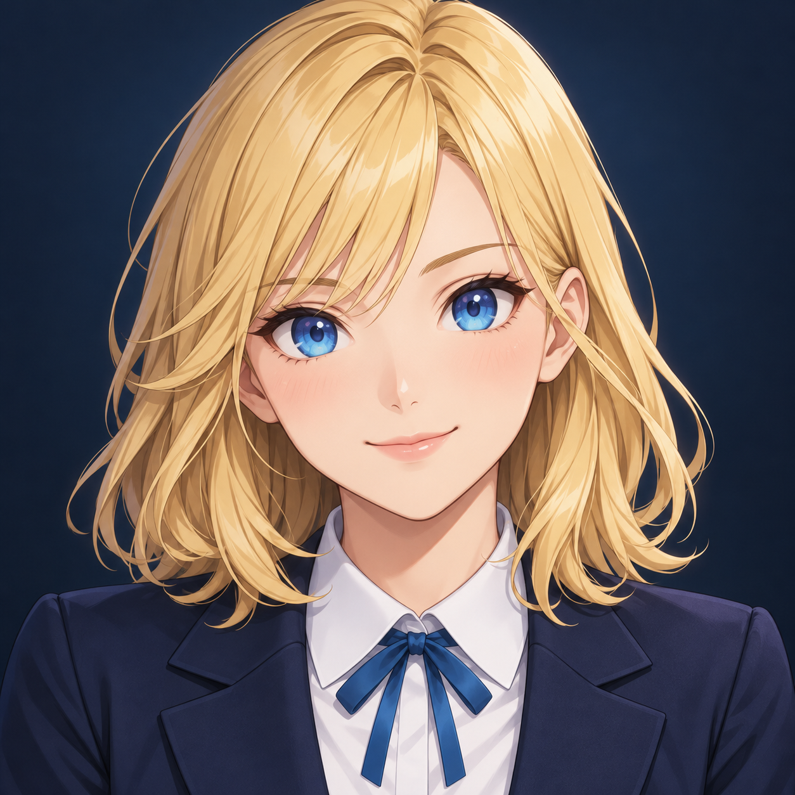
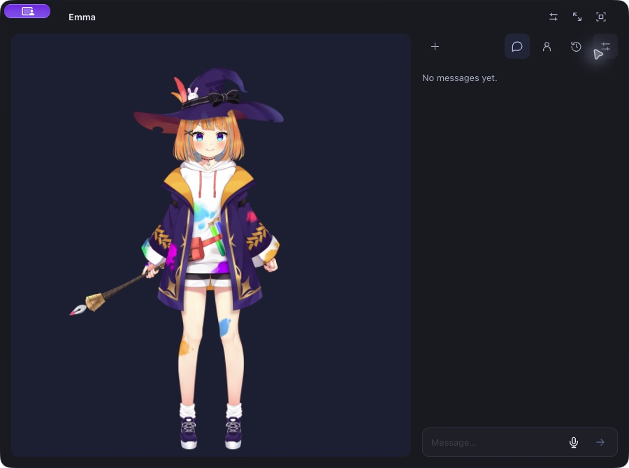
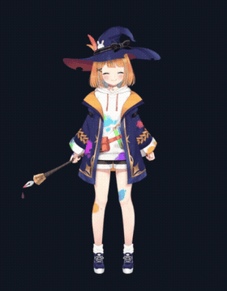
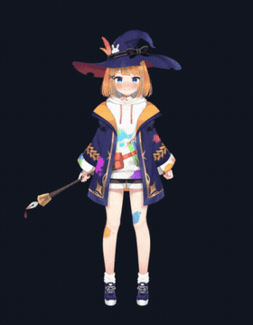
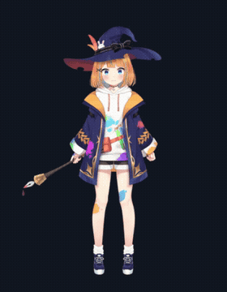
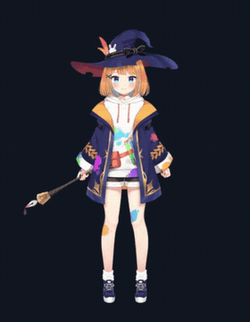
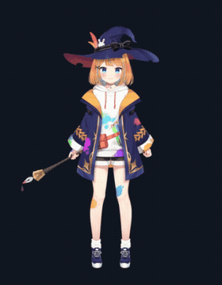
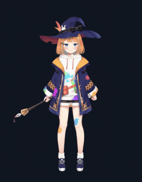
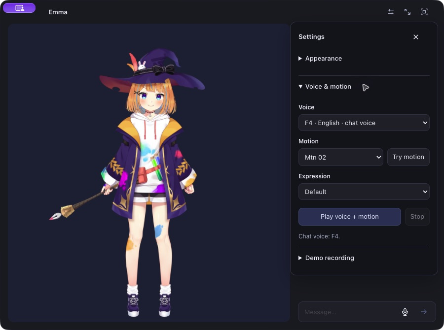

<p align="center"></p>

# Emma Darwin

A funny little AI companion for your Mac, built with help from AI. She talks, reacts, and hangs out on your desktop. Made by [Up-to-code](https://github.com/Up-to-code).

Emma uses a local language model, English Supertonic 3 F4 speech, local speech recognition, and a Live2D character. The app icon is original artwork; the default animated character is Live2D’s **Mao Niziiro**, not an original Emma rig.

[Watch Emma introduce herself](docs/media/emma-intro.mp4) · [Download the Mac app](https://github.com/Up-to-code/edwardarwin/releases/latest) · [Introduction transcript](docs/INTRODUCTION.md)



## What she can do

- Chat by text or microphone, speak English, and react with expressions, gestures, and lip sync.
- Float on your desktop. Drag the character to move the entire window; click her for a reaction.
- Use compact icon controls for chat, history, settings, and desktop tools.
- Open supported Mac apps and links in Chrome using a finite MCP tool set.
- Save website URLs, notes, and tags in SQLite; find them again later.
- Remember details you explicitly share and text files you choose.
- Capture a selected screen, extract screen text for your review, or record screen video.
- Regenerate replies and delete conversations through the interface.
- Record an avatar introduction and emotion reel from Settings → Demo recording.

She does not have unrestricted computer control. Screen reading is on demand; screen video is silent and limited to five minutes. macOS permissions still apply. A small local model can misunderstand instructions, so check the results of desktop actions.

## Emotion previews

These GIFs are recorded from the actual Live2D renderer. Expressions ease in and retain the character’s idle animation.

| Happy | Blushing | Surprised |
| --- | --- | --- |
|  |  |  |
| Sad | Angry | Sleepy |
|  |  |  |

## Install on macOS

Tested on **Apple Silicon with macOS 27**. Native Liquid Glass requires macOS 26 or later; this release does not include an Intel build. Allow several GB for the app, Python dependencies, and models. The Mac app is an unsigned development build, not a notarized App Store release.

1. Install [Homebrew](https://brew.sh/) if needed, then install dependencies:

   ```sh
   brew install uv node ollama
   ```

2. Download the source, or clone it:

   ```sh
   git clone https://github.com/Up-to-code/edwardarwin.git
   cd edwardarwin
   ```

3. Obtain **Cubism SDK for Web** from [Live2D’s official download page](https://www.live2d.com/en/sdk/download/web/), review its license, and copy `Core/live2dcubismcore.js` into `live2d-ui/src/renderer/WebSDK/Core/`. Cubism Core is proprietary and is intentionally not distributed as a standalone runtime in this source release.

4. Prepare the local backend and web interface:

   ```sh
   ./setup-macos.command
   ```

   This installs Python 3.12 dependencies, downloads Supertonic 3 and SenseVoice, pulls `qwen3:1.7b` into Ollama, and builds the UI. It does not upload your personal files.

5. Download and unzip **Emma-Darwin-macOS-arm64.zip** from [Releases](https://github.com/Up-to-code/edwardarwin/releases/latest). Move `Emma Darwin.app` to `~/Applications`, open it, and choose the source folder from step 2. If macOS blocks this unsigned build, review it and use macOS’s normal Open Anyway flow in Privacy & Security.

   To build the Mac app yourself instead, install Xcode Command Line Tools (`xcode-select --install`), then run:

   ```sh
   ./install-macos.command
   ```

6. Use the float icon in the header, or run `./run-desktop-avatar.command` to start floating mode.

Microphone and screen capture require the relevant permissions in **System Settings → Privacy & Security**. Enable screen access only when you want to use capture or screen-text tools. Chrome needs to be installed for opening links. If another Ollama server is already running, setup uses that server’s existing model directory.

## Local models

| Component | Tested model/version | Approximate model assets |
| --- | --- | --- |
| English speech | Supertonic 3, F4; Python `supertonic==1.3.1` | 381 MiB |
| Speech recognition | SenseVoice, sherpa-onnx int8, 2024-07-17 | 228 MiB |
| Language model | Ollama `qwen3:1.7b` | 1.3 GB |
| Desktop shell | Electron 44.7.0, arm64 | Separate app download |

Model weights are downloaded during setup, rather than included in Git. Supertonic’s tested revision is pinned in `scripts/download_models.py`; the SenseVoice ONNX download is verified by SHA-256. Ollama’s model tag may change upstream.

## Your data

Chats, source bookmarks, and profile references live in `data/nori.sqlite3` in your source folder. The legacy filename is retained for compatibility. Captures are saved under `data/captures/`; temporary speech files are under `cache/`. These folders, personal configuration, bridge credentials, and logs are excluded from Git.

The default LLM, voice, and speech recognition run locally. Downloading dependencies/models and opening websites use the network. Additional providers can send data elsewhere if you deliberately configure them. The local API listens on `127.0.0.1:12393`; do not expose it publicly.

## Development

```sh
cd live2d-ui
npm run build:web
npm run typecheck:node
npm run build
```

Start the backend with `../start-local-services.command`. The desktop shell loads the built frontend from that local backend. Native glass source is in `live2d-ui/native/glass/`; the screen OCR helper uses Apple Vision. The complete project lives in this one repository.

Renderer type checking currently reports inherited strictness errors in the upstream Cubism SDK. Production web and Electron builds pass; this release has been exercised locally, not verified on a fresh Mac.

## License and credits

**This is a mixed-license source release, not a wholly MIT/open-source app.** The Python backend is MIT. The inherited desktop/frontend has the **Open-LLM-VTuber License 1.0**, which restricts commercial redistribution. Live2D Core is proprietary, and sample models have their own terms. Model weights have separate licenses, including Supertonic’s BigScience Open RAIL-M restrictions. See [THIRD_PARTY_NOTICES.md](THIRD_PARTY_NOTICES.md) before redistributing or selling it.

Built on [Open-LLM-VTuber](https://github.com/Open-LLM-VTuber/Open-LLM-VTuber), its [Web frontend](https://github.com/Open-LLM-VTuber/Open-LLM-VTuber-Web), [Supertonic](https://github.com/supertone-inc/supertonic), [sherpa-onnx](https://github.com/k2-fsa/sherpa-onnx), [Ollama](https://github.com/ollama/ollama), and [Live2D](https://www.live2d.com/). Rig workflow experiments in the original workspace use [live2d-agent-kit](https://github.com/Ariakage/live2d-agent-kit).

This content uses sample data owned and copyrighted by Live2D Inc. The sample data are utilized in accordance with terms and conditions set by Live2D Inc. This content itself is created at the author’s sole discretion.


